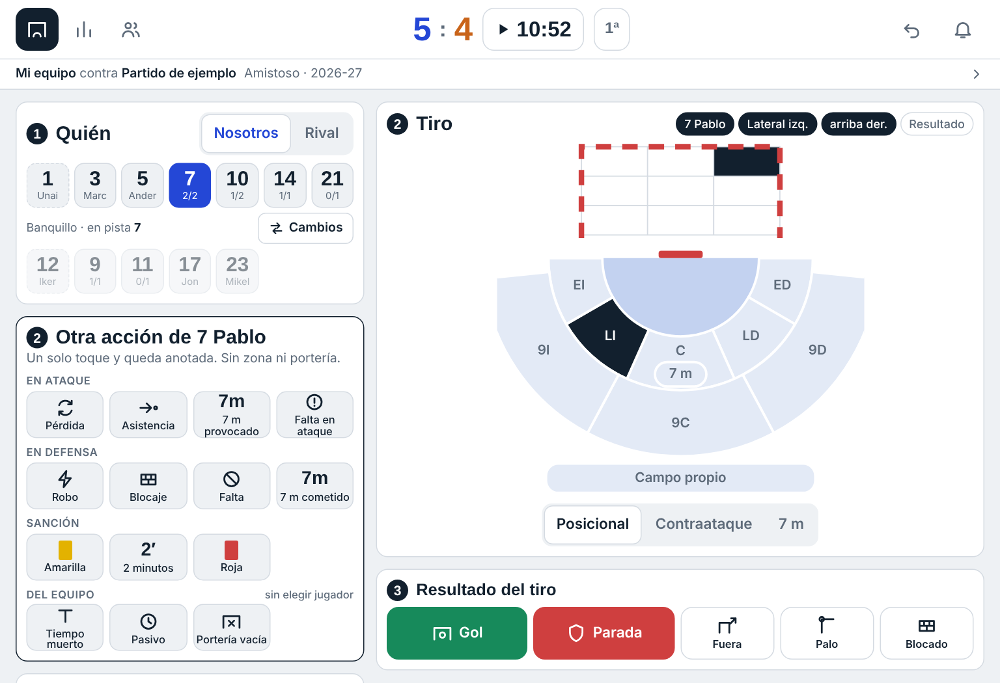

# Handball Scorer · Anotador de balonmano

Aplicación web para anotar partidos de balonmano en directo desde una tablet o un móvil y analizarlos después. Se instala como una app, funciona sin conexión y guarda los datos solo en tu dispositivo: no hay cuentas ni servidor.



## Qué hace

- **Registro rápido en directo:** quién, tiro (zona de pista, cuadrante de portería y resultado) u otra acción con un solo toque (pérdida, robo, falta, sanción…).
- **Jugadores en pista y cambios,** con el tiempo jugado por cada uno.
- **Estadísticas del partido:** comparativa de equipos, mapas de tiro, porteros, evolución del marcador, parciales y ficha de cada jugador.
- **Acumulados** por equipo, temporada y competición, con valoración por partido y por 60 minutos.
- **Varios equipos, rivales guardados, temporadas y competiciones;** los amistosos van fuera de competición.
- **Tus datos son tuyos:** copia completa en JSON y exportación a CSV.

## Empezar

1. Abre **https://inyakisainz.github.io/handball-scorer/** en la tablet o el móvil.
2. Instálala como app: [instrucciones para Android, iPhone, iPad y ordenador](docs/instalacion.md).
3. Sigue la [guía de uso](docs/guia-de-uso.md): crear tu equipo, tu primer partido y anotar.

La app abre con un partido de ejemplo para que puedas practicar antes de un partido real.

## Documentación

| Documento | Contenido |
| --- | --- |
| [Instalación](docs/instalacion.md) | Instalarla como app, comprobar que funciona sin conexión, actualizarla y alojarla en tu propio servidor |
| [Guía de uso](docs/guia-de-uso.md) | Preparar equipo y partido, anotar, cambios, estadísticas, valoración y copias de seguridad |
| [Historial de versiones](CHANGELOG.md) | Qué cambia en cada versión |

## Datos y privacidad

- Todo se guarda en el almacenamiento del navegador del dispositivo. Nada se envía a ningún servidor.
- Si borras los datos del navegador o desinstalas la app, se pierden. **Exporta una copia después de cada partido.**
- Los nombres de los jugadores son datos personales. Si anotas equipos de menores, informa al club y no publiques las copias ni los CSV.
- Las tipografías se descargan de Google Fonts la primera vez; después quedan guardadas en el dispositivo.

## Estado y límites

Es una versión de pruebas, pensada para un anotador por partido.

- Sin sincronización entre dispositivos: para pasar datos de uno a otro se exporta e importa una copia, y la importación sustituye lo que hubiera.
- Sin detalle avanzado del tiro (tipo, trayectoria, presión), sin consola remota para el banquillo, sin vídeo y sin informe PDF.
- Los minutos en pista dependen de que el anotador marque los cambios.
- Solo se siguen los jugadores en pista del equipo propio.
- Un partido ya creado no se puede cambiar de rival ni de competición.

## Desarrollo

No hay dependencias ni paso de compilación. Toda la aplicación está en `public/index.html`.

| Ruta | Para qué sirve |
| --- | --- |
| `public/index.html` | Interfaz, lógica y estilos |
| `public/sw.js` | Service worker: caché para funcionar sin conexión |
| `public/manifest.webmanifest` | Datos para instalarla como app |
| `public/icon-*.png` | Iconos |
| `.github/workflows/pages.yml` | Publica `public/` en GitHub Pages en cada push a `main` |

Para probar en local:

```
cd public
python3 -m http.server 8080
```

Abre `http://localhost:8080`. En `localhost` el navegador permite el service worker sin HTTPS.

Al publicar una versión nueva, cambia `VERSION` en `public/sw.js` y añade una entrada en `CHANGELOG.md`. Los dispositivos reciben la versión nueva la segunda vez que abren la app con conexión.

## Licencia

Este repositorio todavía no tiene licencia. Mientras no se publique una, el código puede consultarse pero no hay permiso para reutilizarlo ni redistribuirlo.
