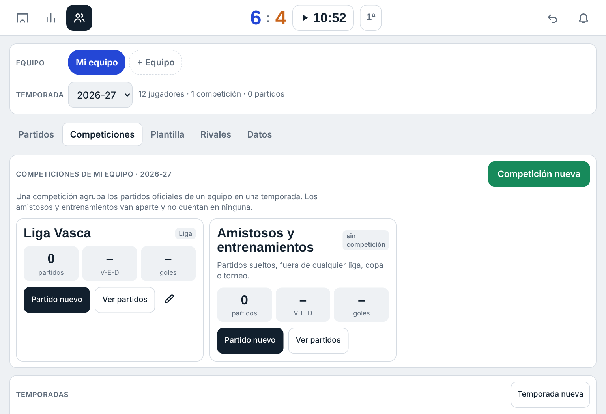
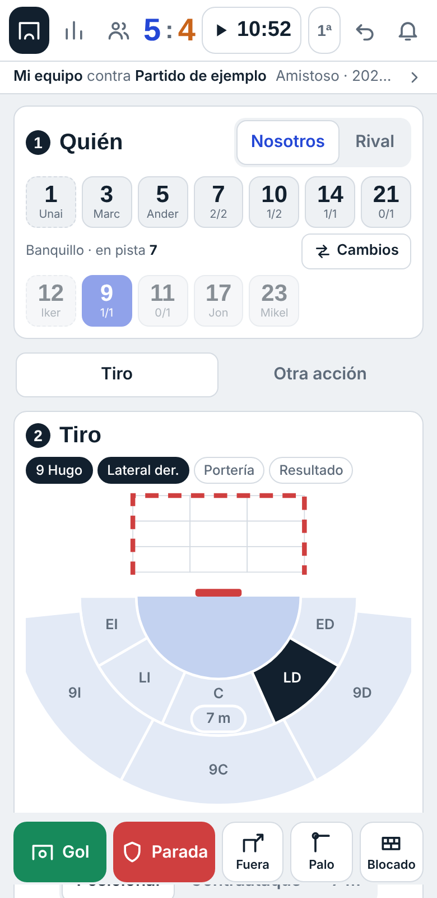
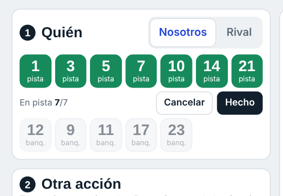
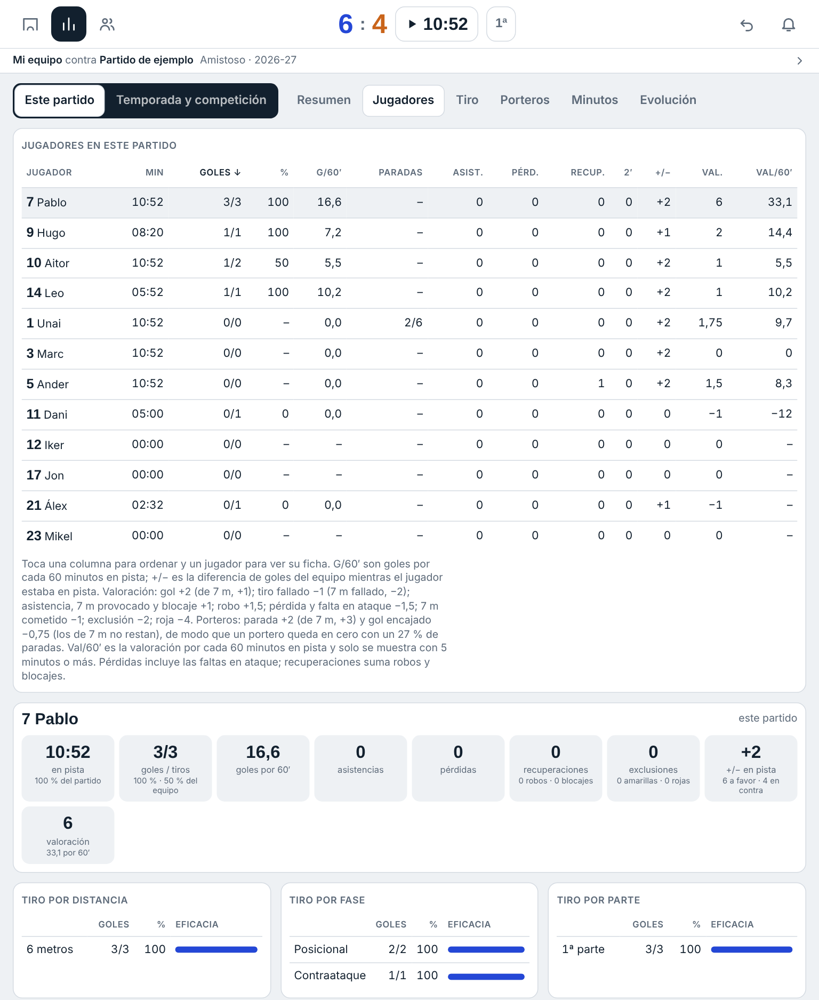

# Guía de uso

## La pantalla, de un vistazo

Arriba hay tres iconos y el marcador:

| Icono | Pantalla |
| --- | --- |
| Portería | **Registro:** donde se anota el partido |
| Barras | **Estadísticas:** del partido y acumuladas |
| Personas | **Gestión:** partidos, competiciones, plantilla, rivales y datos |

Bajo la cabecera, una barra indica siempre qué partido está abierto: equipo, rival, competición y temporada. Tocarla lleva a la gestión.

A la derecha de la cabecera están **deshacer** (la flecha) y la **campana**, que guarda un hueco en la cronología para completar más tarde algo que no te dio tiempo a anotar.

## Antes del primer partido

La app abre con un partido de ejemplo. Puedes practicar con él y borrarlo cuando quieras.

### 1. Crea tu equipo

1. Abre la gestión (icono de personas).
2. Arriba, toca **+ Equipo**, escribe el nombre y pulsa **Crear equipo**. Si solo vas a llevar un equipo, puedes renombrar el que viene creado en la pestaña **Plantilla**.
3. En **Plantilla**, pulsa **Añadir jugador** por cada uno y rellena dorsal y nombre. Marca **Portero** en los porteros.

### 2. Crea la competición (opcional)

1. Comprueba arriba que están elegidos tu equipo y la temporada.
2. En **Competiciones**, pulsa **Competición nueva**, ponle nombre y elige formato (Liga, Copa, Torneo u Otra).

Los amistosos y entrenamientos no necesitan competición: tienen su propia tarjeta.

### 3. Crea el partido

1. En **Partidos**, pulsa **Partido nuevo**. También puedes hacerlo desde la tarjeta de una competición.
2. Elige el rival (o **Rival nuevo…** y escribe su nombre) y la competición. Para un partido suelto elige **Amistoso**.
3. Ajusta fecha, campo, número de partes y minutos por parte.
4. Si conoces los dorsales rivales, escríbelos separados por comas. Si no, podrás añadirlos durante el partido.
5. Pulsa **Crear y empezar**.

## Anotar el partido

La regla es siempre la misma: **primero quién, después qué**.

### Antes del saque

- Revisa el **siete inicial**. La app propone el primer portero y los seis primeros jugadores de la plantilla. Para cambiarlo, pulsa **Cambios** en el bloque Quién, marca los que salen de inicio y pulsa **Hecho**.
- Pulsa el **reloj** para ponerlo en marcha. Vuelve a pulsarlo para pararlo.

### Un tiro

1. **Quién:** toca el jugador. Si ataca el rival, toca **Rival** y su dorsal, o el interrogante si no lo conoces.
2. **Tiro:** toca la zona de la pista desde la que tira y el cuadrante de la portería al que va. Las etiquetas de arriba muestran lo que llevas marcado.
3. **Resultado:** Gol, Parada, Fuera, Palo o Blocado.

Zona y cuadrante se pueden marcar en cualquier orden, y son opcionales: si no te da tiempo, pulsa solo el resultado. Para un contraataque o un 7 m, márcalo en el selector de fase antes del resultado.

Después de cada tiro, el ataque pasa solo al otro equipo.

### Otra acción

1. Toca el jugador.
2. Toca un botón del bloque **Otra acción**. No hace falta zona ni portería.

| Grupo | Acciones |
| --- | --- |
| En ataque | Pérdida, asistencia, 7 m provocado, falta en ataque |
| En defensa | Robo, blocaje, falta, 7 m cometido |
| Sanción | Amarilla, 2 minutos, roja |
| Del equipo | Tiempo muerto, pasivo, portería vacía. No necesitan jugador |

En móvil, un selector alterna entre **Tiro** y **Otra acción**. En tablet se ven los dos a la vez.

### Cambios y jugadores en pista

- Los jugadores en pista aparecen arriba; el banquillo, debajo y atenuado.
- Para un cambio: **Cambios**, toca quién sale y quién entra (máximo siete en pista) y **Hecho**.
- Una exclusión o una roja saca al jugador de pista automáticamente. Cuando vuelva, márcalo en Cambios.
- Si anotas una acción de alguien que figura en el banquillo, la app te avisa para que revises los cambios.

Marcar los cambios es lo que permite calcular los minutos de cada jugador.

### Partes

El botón con el número de parte (1ª, 2ª) pasa a la siguiente. Cada parte tiene su propio reloj, que se para solo al llegar a su duración.

### Corregir

- **Deshacer:** la flecha de la cabecera anula lo último.
- **Editar:** toca un evento en la cronología, cambia lo que haga falta y vuelve a pulsar el resultado o la acción.
- **Borrar:** la papelera junto al evento.
- **Completar después:** la campana deja una marca con la hora; tócala luego en la cronología para rellenarla.

## Estadísticas

Arriba se elige el nivel: **Este partido** o **Temporada y competición**.

### Este partido

| Pestaña | Qué muestra |
| --- | --- |
| Resumen | Comparativa de los dos equipos, eficacia por fase y por situación numérica, y tabla de jugadores |
| Jugadores | Tabla ordenable y ficha de cada jugador |
| Tiro | Goles y tiros por zona y cuadrante, de tu equipo o del rival, por jugador |
| Porteros | Paradas por zona, cuadrante y tirador rival |
| Minutos | Tiempo en pista, +/− y alineaciones usadas |
| Evolución | Marcador a lo largo del partido y parciales cada cinco minutos |

Resumen, Tiro y Porteros se pueden filtrar por parte; Tiro y Porteros, también por fase de juego.

En **Jugadores**, toca una cabecera para ordenar y un jugador para abrir su ficha: tiempo en pista, goles y tiros, ritmo por 60 minutos, asistencias, pérdidas, recuperaciones, sanciones, +/−, valoración, tiro por distancia, fase y parte, mapa de zonas y la lista de sus acciones. En los porteros la ficha se centra en las paradas.

### Temporada y competición

Arriba se elige equipo, temporada y ámbito: toda la temporada, solo amistosos y entrenamientos, o una competición.

- **Jugadores:** la misma tabla sumando los partidos elegidos, con partidos jugados, minutos por partido y valoración media. La ficha añade los goles por partido y el detalle partido a partido.
- **Equipo:** evolución de la eficacia de tiro y del portero, comparación del partido abierto con la media y enfrentamientos con ese rival.

### Qué significa cada columna

| Columna | Significado |
| --- | --- |
| PJ | Partidos en los que el jugador estuvo en pista o tuvo alguna acción |
| Min | Tiempo en pista. Necesita que se hayan marcado los cambios |
| G/60′ | Goles por cada 60 minutos en pista |
| Pérd. | Pérdidas de balón más faltas en ataque |
| Recup. | Robos más blocajes |
| +/− | Diferencia de goles del equipo mientras el jugador estaba en pista |
| Val. | Valoración, según la tabla siguiente |
| Val/60′ | Valoración por cada 60 minutos en pista. Solo con cinco minutos o más |

### Valoración

| Acción | Puntos |
| --- | --- |
| Gol | +2 |
| Gol de 7 m | +1 |
| Tiro fallado (parado, fuera, palo o blocado) | −1 |
| 7 m fallado | −2 |
| Asistencia | +1 |
| 7 m provocado | +1 |
| Blocaje | +1 |
| Robo | +1,5 |
| Pérdida | −1,5 |
| Falta en ataque | −1,5 |
| 7 m cometido | −1 |
| Exclusión de 2 minutos | −2 |
| Roja | −4 |
| Parada (portero) | +2 |
| Parada de 7 m (portero) | +3 |
| Gol encajado (portero) | −0,75 |
| Gol encajado de 7 m (portero) | 0 |

No puntúan las amarillas ni las faltas defensivas. Con estos pesos, un portero queda en cero con un 27 % de paradas en juego. Es una escala orientativa propia de esta aplicación, no un índice oficial.

## Rivales

En la gestión, pestaña **Rivales**, se guardan los rivales de cada equipo con sus dorsales y, si quieres, sus nombres. Al crear un partido contra un rival guardado, sus dorsales se cargan solos. Los que añadas durante un partido con el botón **+** quedan guardados para la próxima vez.

## Copias y exportación

En la gestión, pestaña **Datos**:

| Botón | Para qué sirve |
| --- | --- |
| Exportar copia completa (JSON) | Guarda todo: equipos, rivales, competiciones y partidos. Es tu copia de seguridad |
| Importar copia | Carga una copia. **Sustituye todo lo que haya en el dispositivo** |
| Todos los partidos (CSV) | Una fila por evento, para Excel u otras herramientas. Usa punto y coma como separador |

En la lista de partidos, cada uno tiene además su propio botón **CSV**.

Para pasar los datos a otro dispositivo: exporta la copia en el primero, envíate el archivo e impórtalo en el segundo.

## Preguntas frecuentes

**¿Puedo anotar entre dos personas a la vez?**
No. Cada partido lo anota un único dispositivo.

**He cambiado el dorsal de un jugador y sus partidos anteriores no le cuentan.**
Los eventos guardan el dorsal. Los partidos ya anotados conservan el antiguo.

**No me salen minutos ni Val/60′.**
Hay que marcar quién está en pista con Cambios. En partidos donde no se hizo, aparece un guion.

**Me he equivocado de rival o de competición al crear el partido.**
De momento no se puede cambiar: hay que borrar el partido y crearlo de nuevo.

**¿Un amistoso cuenta en las estadísticas de la temporada?**
Sí en "Toda la temporada"; no en las de una competición concreta. También puedes ver solo los amistosos.
